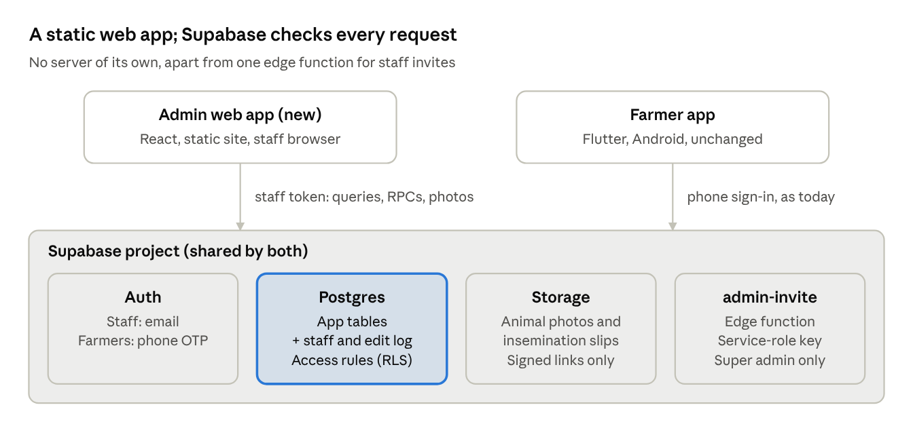

# WeSTOCK Admin — Developer Build Guide

Nov 6, 2026 

## Start here

You are building a web dashboard for brainwired staff on top of the WeSTOCK Supabase project the Flutter farmer app already uses. The screens were designed and made clickable first. This guide turns that prototype into build instructions: what to set up, what SQL to run, and what each screen reads and writes.

| Source | What it is | Use it for |
| --- | --- | --- |
| [Design prototype](https://claude.ai/artifact/9jQa5qhU3LeB3EbPcj9VxS) | 18 clickable screens (11 for phase 1) | Layout, wording, every button's behaviour, phone layout. This is the visual source of truth |
| [Product spec](https://claude.ai/artifact/UL6z5HMmJSVjg9WcW3ycJm) | Scope, roles, data model, open questions | What is in phase 1 and why |
| Build pack (`wsk.zip`) | `AGENTS.md`, `BACKEND_SETUP.md`, `supabase/migrations/0001–0004`, edge functions | Existing table names, enums, access helpers, app conventions |
| This guide | Setup, migration, per-screen build sheet, tests, launch | How to build it |

The prototype's actions are simulated: changes reset on reload and CSVs hold sample data. Every one of them must be replaced by a real Supabase read or write.

**Phase 1 screens:** Sign in, Dashboard, Farmers & farms, Farm page, Livestock, Animal page, Reproduction, Milk & feed, Health & vaccines, Analytics, Staff & activity log. The seven Later screens (Devices, Support, Notifications, Account requests, Species, Gau, Weather) are out of scope; leave their routes out.

**Done means**

- [ ] All 11 screens match the prototype at 1440 px and 390 px wide, with no sideways page scroll on a phone.
- [ ] Every button and filter on those screens works against Supabase, with no mock data left.
- [ ] A Viewer can't change anything, and the database enforces it (not just hidden buttons).
- [ ] Every staff edit writes an activity log row with the before and after values.
- [ ] The farmer app behaves exactly as before: migration `0005_admin.sql` only adds.
- [ ] Signed off on the test copy before anything touches the live database.

## Architecture

The dashboard is a static web app that talks straight to the app's Supabase project with the signed-in staff member's token. Postgres access rules decide what each request can see and change, so there is no backend to build or host.



The farmer app keeps working exactly as today. The only server-side code is `admin-invite`, because creating a login needs the service-role key, which must never reach a browser.

**Recommended stack** (the app's `AGENTS.md` fixes the app's stack, not this one, so confirm before starting)

| Layer | Recommended | Why |
| --- | --- | --- |
| UI | React + TypeScript, built with Vite | Static build, dense tables and exports are straightforward, easy to hire for |
| Routing | React Router | Filters live in the URL |
| Data | `supabase-js` v2 + TanStack Query | Typed queries, caching, refresh on tab focus |
| Forms | React Hook Form + Zod | Same validation in every dialog (12-digit Pashu Aadhaar, 10-digit phone, reason required) |
| Charts | Recharts, or small SVG components like the prototype | Bars and lines only |
| Styling | CSS variables from the tokens, plus CSS modules | Matches the prototype one to one |
| Tests | Playwright for screens; SQL scripts for access rules | Covers the UI and the database separately |
| Hosting | Any static host (Vercel, Netlify, Cloudflare Pages) | Nothing to run but files |

Flutter Web could share code with the app, but it is weaker at what this dashboard does most: long tables, text selection, browser search and CSV downloads.

## Setup

All development runs against the **test copy** of the database. Nobody needs live access until launch.

**Repo layout**

```text
westock-admin/
  src/
    app/         router, layout, auth and role guards
    lib/         supabase client, queries, CSV, formatters
    components/  KpiCard, StatusPill, DataTable, Pagination,
                 Modal, ConfirmDialog, Toast, Segmented,
                 EmptyState, charts/
    features/    auth/ dashboard/ farmers/ farm/ livestock/
                 animal/ reproduction/ milk-feed/ health/
                 analytics/ staff/
    styles/      tokens.css
  supabase/
    functions/admin-invite/index.ts
    seed/test_seed.sql
  tests/         rls/ (SQL), e2e/ (Playwright)
  .env.example
```

The migration `0005_admin.sql` goes in the **backend repo** next to `0001–0004`, not here. The Supabase project has one migration history; two repos pushing migrations to it will clash.

**Environment variables**

| Variable | Value | Where |
| --- | --- | --- |
| `VITE_SUPABASE_URL` | `https://<project-ref>.supabase.co` | `.env.local` (web app) |
| `VITE_SUPABASE_ANON_KEY` | The project's anon key | `.env.local` (web app) |
| `VITE_APP_ENV` | `test` or `live` | `.env.local`. Shows a "Test data" banner when `test` |
| `ADMIN_SITE_URL` | The dashboard's web address | Edge function secret, used in invite and reset links |
| `SUPABASE_SERVICE_ROLE_KEY` | Provided to edge functions automatically | Edge functions only. Never in the web app |

**First run**

1. `git clone` the repo, then `npm install`.
2. Copy `.env.example` to `.env.local` and fill in the **test** project URL and anon key.
3. In the backend repo: `supabase link --project-ref <test-ref>`, then `supabase db push` (applies `0001–0005`).
4. Load dummy farms: `psql "$TEST_DB_URL" -f supabase/seed/test_seed.sql`.
5. Create the first Super admin: add an email user in Authentication → Users, then run `insert into admin_staff (user_id, full_name, email, role, status) values ('<user id>', '<name>', '<email>', 'super_admin', 'active');`
6. `supabase functions deploy admin-invite` and `supabase secrets set ADMIN_SITE_URL=http://localhost:5173`.
7. In Authentication → URL Configuration, add `http://localhost:5173/**` to the redirect URLs.
8. `npm run dev`, open `http://localhost:5173` and sign in.

**Auth settings to leave alone:** keep "Allow new users to sign up" on, because the farmer app's phone sign-up needs it. Turn on the Email provider for staff. Anyone who signs up by email without an `admin_staff` row is shown a "no access" page, and the database returns nothing to them.

## Database migration: `0005_admin.sql`

One migration adds everything the dashboard needs. It only adds: no existing table, column, policy or function is renamed or removed, so the farmer app is unaffected. Postgres combines access rules with OR, so the new staff rules sit alongside the farmers' rules without changing them.

| Part | What it adds |
| --- | --- |
| 1. Staff | `admin_staff` table, role helpers `admin_role()`, `is_admin_staff()`, `is_admin_editor()`, `is_super_admin()`, and `admin_touch()` |
| 2. Farm columns | `farms.district`, `farms.state`, `farms.poultry_count` |
| 3. Access rules | Staff read rules on farm tables and photos; edit rules for Support and Super admin; farm delete for Super admin only |
| 4. Activity log | `admin_audit_log` table and the `admin_audit()` trigger on every editable table |
| 5. Edits with a reason | `admin_fix_milk()`, `admin_fix_feed()`, `admin_delete_entry()` |
| 6. List views | `admin_farm_list`, `admin_farmer_list` for the Farmers & farms screen |
| 7. Screen helpers | admin\_animal\_list, admin\_milk\_daily, admin\_feed\_daily, admin\_species\_counts views, and admin\_transfer\_farm() |

The full SQL is in **Appendix A** at the end of this guide. It was run on Postgres 16 on top of the build pack's `0001–0004`, and 30 checks pass: farmers still see only their own farm, Viewers can't change anything, Support can't delete farms or touch the log, every staff edit is logged with its reason, and a farm delete logs one row.

**Notes for whoever runs it**

- The app's `farm_dashboard()` and `analytics_series()` are `security invoker`, so once the staff read rules exist they work for staff with no change.
- Every new auth user gets a `profiles` row through the app's `handle_new_user()` trigger, staff included. `admin_farmer_list` filters staff out, and it lists farm **owners** only. Workers appear under each farm's members.
- A farm delete is logged as one row, with the farm's last values in `changes`. The rows deleted with it are not logged one by one.
- Test it on the test copy with the checks in Testing and QA before it goes anywhere near live.

## Sign-in and roles

Staff sign in with email and password through Supabase Auth, the same project where farmers sign in with a phone OTP. Access depends on the `admin_staff` row, not on how someone signed in.

**Flows**

| Flow | What the web app does | What the database does |
| --- | --- | --- |
| Sign in | `supabase.auth.signInWithPassword({ email, password })`, then `rpc('admin_touch')`, then reads its own `admin_staff` row | `admin_touch()` turns an invite into an active account and stamps `last_active_at` |
| No access | No row, or status `removed` → show "You don't have access to this dashboard" and sign out | Every staff read rule returns nothing |
| Forgot password | `resetPasswordForEmail(email, { redirectTo: <site>/reset-password })`; that page calls `updateUser({ password })` | Supabase sends the email |
| Invite (Super admin) | Calls the `admin-invite` edge function with name, email and role | The function checks the caller is a Super admin, calls `auth.admin.inviteUserByEmail()` and inserts the `admin_staff` row with status `invited` |
| Change role | `update admin_staff set role = …` | Allowed for Super admin only; logged |
| Remove staff, cancel invite | `update admin_staff set status = 'removed'` | Access ends at once, because every rule checks `status = 'active'`. Their past log rows stay |
| Session check | Re-read the `admin_staff` row when the tab regains focus | A removed or demoted user loses access on their next request either way |

**What each role sees in the UI**

| Role | Hide or disable | Database backstop |
| --- | --- | --- |
| Viewer | Every add, edit, fix, delete, mark and transfer button. Keep exports and the activity log | No insert, update or delete rule matches; the RPCs raise `not_allowed` |
| Support | Staff management (invite, role, remove) and "Delete farm" | `admin_staff` update and farm delete need Super admin |
| Super admin | Nothing hidden. Can't remove or demote themselves (UI check) | — |

Hiding buttons is for clarity only. Security comes from the access rules, so a Viewer calling the API directly still can't change anything.

**`admin-invite` edge function**

| Step | Detail |
| --- | --- |
| Input | `{ full_name, email, role }`, sent with the caller's sign-in token |
| 1. Check the caller | Create a client with the caller's token and run `select is_super_admin()`. If false, return 403 |
| 2. Invite | With the service-role client: `auth.admin.inviteUserByEmail(email, { redirectTo: ADMIN_SITE_URL + '/set-password' })` |
| 3. Record | Insert `admin_staff (user_id, full_name, email, role, status 'invited', invited_by)` |
| Errors | Email already a staff member → 409. Email already a farmer account → 409 with "use a work email" |

## Design tokens and shared components

Put every colour and size in `src/styles/tokens.css` as a CSS variable, and use only the variables in components. The values come from the app's build pack and match the prototype exactly.

**Tokens**

| Variable | Value | Use |
| --- | --- | --- |
| `--navy` | `#0F1B2D` | Sidebar, headings, text on green |
| `--green` | `#2ED08C` | Primary buttons, active tab |
| `--green-ink` | `#0B7A4B` | Eyebrow labels, links, success text |
| `--bg` | `#F4F6F5` | Page background |
| `--card` / `--line` | `#FFFFFF` / `#E5EAE7` | Cards and their border |
| `--ink` / `--muted` | `#1A1A1A` / `#6B7280` | Body text / helper text |
| `--danger` | `#D62F4B` | Delete and release buttons |
| `--pill-green` | `#E3F8EF` on `#0B7A4B` | Active, given, resolved |
| `--pill-amber` | `#FFF1E0` on `#9A4A00` | Due soon, needs a look; also Feed |
| `--pill-red` | `#FDE8EC` on `#B4233C` | Overdue, sick; also Health |
| `--pill-blue` | `#E8EDFC` on `#2A4FD6` | Upcoming; also Vaccines |
| `--pill-pink` | `#FBE6F4` on `#A01A78` | Breeding stages |
| `--pill-grey` | `#F1F3F2` on `#374151` | Sold, deceased |
| `--milk` / `--milk-bar` | `#DDF4F9` on `#0E6C80` / `#BEEFF7` | Milk cards and chart bars |
| `--font-head` | Poppins 600 | Titles, numbers (tabular figures) |
| `--font-body` | Nunito 400–800 | Everything else, 14 px base |
| `--radius-card` / `--radius-btn` | 16 px / 12 px | Cards / buttons and inputs |

Load Poppins and Nunito from Google Fonts. Nunito has no Indian scripts, so add Noto Sans Devanagari, Malayalam, Gujarati and Tamil to the font stack as fallbacks. Farmer names and notes arrive in those scripts.

**Shared components**

| Component | Used on | Behaviour |
| --- | --- | --- |
| `AppShell` (Sidebar + TopBar) | Every screen except Sign in | Sidebar groups: Overview, Farms, Records, Insights, Admin. TopBar: breadcrumb, global search, today's date, alerts bell |
| `GlobalSearch` | TopBar | Searches farms, farmers (name, phone) and animal tags; shows up to 8 results; Enter opens the first |
| `KpiCard` | Dashboard, lists | Label, big number, note, optional trend and link |
| `StatusPill` | All tables | One of the six pill tokens; text always says the state, so colour is never the only signal |
| `DataTable` | All lists | Sticky header, 20 rows a page, sort on dated columns, empty state with "Clear filters" |
| `FilterBar` | All lists | Search box (debounced 300 ms) plus selects; values kept in the URL query |
| `Modal` | All add, edit and fix actions | Opens near the clicked button, Escape and the backdrop close it, focus stays inside |
| `ConfirmDialog` | Delete, release, transfer | Red action; destructive ones ask the user to type a word to confirm |
| `Toast` | After every save | Dark, 3 seconds, says what happened ("Invite sent to …") |
| `Segmented` | Period, view and tab switches | `aria-pressed` on each option |
| Charts | Dashboard, Milk & feed, Analytics, Animal | Bars for daily totals, lines for temperature and THI; tooltips with the exact value |

**Phone rules (900 px and below)**

| Element | On a phone |
| --- | --- |
| Sidebar | Becomes a strip across the top that scrolls sideways |
| KPI grid | One card per row |
| Tables | Scroll sideways inside their card; the page itself never scrolls sideways |
| Secondary columns | Hidden (marked `hide-sm` in the prototype) |
| TopBar | Breadcrumb and date hidden; search and bell stay |
| Modals | Full width with a 16 px margin |

## Screen-by-screen build sheet

For each phase 1 screen: its route, what it reads, what it writes, and what to watch for. Filters live in the URL query, so a filtered view can be shared as a link. The product spec lists each screen's parts and buttons; the prototype shows exactly how they look and behave.

### Sign in

| Item | Detail |
| --- | --- |
| Routes | `/login`, `/reset-password`, `/set-password` (invite link lands here) |
| Reads | Own `admin_staff` row after sign-in |
| Writes | `rpc('admin_touch')` once per session |
| Watch for | One error message for wrong email or password ("Email or password is wrong"), so the page doesn't reveal which emails exist |

### Dashboard

| Item | Detail |
| --- | --- |
| Route | `/` |
| Totals | Count on `admin_farmer_list`; count on `farms`; sum of `admin_species_counts.animals`; `admin_milk_daily` for yesterday |
| Last 30 days | `admin_milk_daily`, `admin_feed_daily` for the period; `vaccinations` with `done_date` in the period. Trend = this period against the one before |
| Needs attention | Heat cycles whose `golden_end` falls in the next 6 hours; vaccinations with `done_date` null and `due_date` before today; `health_events` with status `sick`; pregnant cycles with `expected_delivery` within 7 days; `admin_farm_list` rows with `last_entry_at` older than 3 days |
| Herd and languages | `admin_species_counts`; one count per language on `admin_farmer_list` |
| Recent staff changes | `admin_audit_log` ordered by `at` desc, limit 5 |
| Writes | Invite staff through `admin-invite` (Super admin only) |

### Farmers & farms

| Item | Detail |
| --- | --- |
| Route | `/farmers?view=farmers\|farms&q=&state=&lang=&page=` |
| Reads | `admin_farmer_list` or `admin_farm_list`; search with `ilike` on name and phone (farmers) or farm name; `eq` on state and language; `order(last_entry_at desc nulls last)`; `range()` for 20 a page with `count: 'exact'` |
| Totals | Farmers; logged this week (`last_entry_at` within 7 days); quiet 3–7 days; quiet 7+ days |
| Writes | None. Export CSV runs the same query in chunks of 1,000 |

### Farm page

| Item | Detail |
| --- | --- |
| Route | `/farms/:id` |
| Reads | `admin_farm_list` and `farms` row; `sheds`; `farm_members` with `profiles(full_name, phone)`; `rpc('farm_dashboard', { p_farm })`; `rpc('analytics_series', { p_farm, p_days: 7 })`; latest 5 each of milk, feed and health entries, merged by time |
| Writes | `farms` update (name, description, district, state, lat, lng); `settings.high_temp_c` and `settings.offline_after_min` merged into the existing JSON, never replacing it; `sheds` insert and update; `farm_members` insert and role update; `rpc('admin_transfer_farm')`; `farms` delete (Super admin) |
| Watch for | Adding a member looks up `profiles` by phone. No match → "Ask them to sign up in the WeSTOCK app first". Delete asks for the farm name typed exactly |

### Livestock

| Item | Detail |
| --- | --- |
| Route | `/livestock?farm=&cat=&collar=&breeding=&status=&q=&page=` |
| Reads | `admin_animal_list`, filtered on `farm_id`, `category`, `connection_state`, `breeding_status`, `status`; `ilike` on `name` and `tag_number` |
| Totals | Active animals; with collars (`hardware_tag_id` not null); temperature high; cannot connect |
| Writes | `animals` insert: farm, tag, name, species, breed, gender, Pashu Aadhaar (exactly 12 digits) |
| Watch for | Tag numbers are unique per farm. Show "Tag 07 is already used on this farm" instead of the database error |

### Animal page

| Item | Detail |
| --- | --- |
| Route | `/animals/:id` |
| Reads | `admin_animal_list` row; `vaccinations`, `health_events`, `reproduction_cycles` for the animal; `rpc('analytics_series', { p_farm, p_animal, p_days: 30 })`; today's `sensor_readings` and `activity_daily`; photos through `storage.from('animal-photos').createSignedUrl(path, 3600)` |
| Writes | `animals` update (profile fields, `status` sold, deceased or active); `vaccinations` insert and `done_date` update; `health_events` insert and resolve (`status` resolved, `resolved_at` now) |
| Watch for | Collar sections appear only when `hardware_tag_id` is set, as in the app. The status dialog's date and note have no column yet (see open decisions) |

### Reproduction

| Item | Detail |
| --- | --- |
| Route | `/reproduction?stage=heat\|inseminated\|pregnant&farm=` |
| Reads | `reproduction_cycles` with `animals(name, tag_number)` and `farms(name)`, by `status`. Heat sorted by `golden_end`, inseminated by `inseminated_at` desc, pregnant by `expected_delivery` |
| Writes | Insert a cycle (`heat` with `heat_started_at`, or `inseminated` with `inseminated_at` and `tube_number`); set `insemination_verified` true |
| Watch for | Golden periods from collars come from the ML service (`source` = sensor). Staff never edit `golden_start` or `golden_end`. Slip photos load with `createSignedUrl` from `insemination-images` |

### Milk & feed

| Item | Detail |
| --- | --- |
| Route | `/milk-feed?tab=milk\|feed&farm=&period=daily\|monthly&page=` |
| Reads | `milk_entries` or `feed_entries` with `animals(name, tag_number)` and `farms(name)`; "entered by" names from `profiles` in one extra query (`created_by` points at `auth.users`, which can't be joined directly); totals and charts from `admin_milk_daily` and `admin_feed_daily`, or `analytics_series` when one farm is picked |
| Writes | Insert entries (`created_by` = the staff user); fix with `rpc('admin_fix_milk')` or `rpc('admin_fix_feed')` (reason required); delete with `rpc('admin_delete_entry')` |
| Watch for | "Fixed by staff" badge = an `admin_audit_log` update row for that record (one query for the visible page's ids). Monthly report = the daily views summed by month |

### Health & vaccines

| Item | Detail |
| --- | --- |
| Route | `/health?tab=vax\|issues&farm=&species=` |
| Reads | `vaccinations` with `done_date` null and `animals!inner(name, tag_number, species_id)`, grouped as overdue (before today), due (next 7 days), upcoming (8–30 days); `health_events` with status not `resolved` |
| Writes | Mark given: `done_date` = today (Undo sets it back to null). Resolve: `status` resolved, `resolved_at` now (Undo restores both). Schedule: read the farm's active animals of that species, then one insert of a vaccination row per animal |
| Watch for | A schedule for a whole herd writes one log row per animal. That's expected |

### Analytics

| Item | Detail |
| --- | --- |
| Route | `/analytics?farm=&animal=&days=7\|30\|90&shed=&day=` |
| Reads | `rpc('analytics_series', { p_farm, p_animal, p_days })` returns `milk`, `feed`, `activity`, `cattle_temperature` and `farm_temperature`. The farm temperature day picker reads `environment_readings` for that day and shed |
| Writes | None. Download builds a CSV from the same data |
| Watch for | 30 and 90 days show 5-day and 10-day averages, as in the prototype, so the bars stay readable |

### Staff & activity log

| Item | Detail |
| --- | --- |
| Route | `/staff?who=&action=&period=` |
| Reads | `admin_staff`; `admin_audit_log` filtered on `staff_id`, `action`, `table_name` and `at`, 50 at a time with "Load more" (`lt('id', lastId)`) |
| Writes | `admin-invite`; `admin_staff` role and status updates (Super admin) |
| Watch for | Show `changes` as "field: before → after" in plain words ("Litres: 6 → 5.5"), not raw JSON |

## Data access rules

Every screen talks to Supabase through one small query layer in `src/lib`, never straight from a component. These rules keep the screens consistent.

| Topic | Rule |
| --- | --- |
| Query layer | One function per read or write (`listFarms(filters)`, `fixMilkEntry(id, values, reason)`). Components use them through TanStack Query hooks |
| Caching | Query keys include every filter. After a write, invalidate the keys of the lists and totals it affects |
| Paging | 20 rows a page with `.range(from, to)` and `count: 'exact'`. The activity log uses "Load more" instead |
| Search | `ilike` with `%term%`, debounced 300 ms, at least 2 characters. Phone search strips spaces and a leading `+91` |
| Filters | Kept in the URL query, so back and forward work and a filtered view can be shared |
| Dates | Show dates and times in India time (Asia/Kolkata). Date columns (`entry_date`, `due_date`) are plain dates; don't shift them |
| Numbers | Litres to 1 decimal, rupees in Indian grouping (₹1,23,456), kilograms as whole numbers |
| Exports | Same query as the screen, fetched in chunks of 1,000, capped at 50,000 rows. CSV in UTF-8 with a BOM so Excel shows Hindi and other scripts correctly |
| Photos | Private buckets: always `createSignedUrl(path, 3600)`, never a public URL |
| Writes that need a reason | Always through the RPCs (`admin_fix_milk`, `admin_fix_feed`, `admin_delete_entry`, `admin_transfer_farm`), so the reason lands in the log |
| Other writes | Plain `insert` or `update` with `.select()` to get the saved row back. If no row comes back, treat it as "you don't have permission" |
| Realtime | Not needed in phase 1. Lists refresh when the tab regains focus |

**Error messages to show**

| From the database | Show the user |
| --- | --- |
| `not_allowed` | "Your role can't make this change." |
| `reason_required` | "Add a reason for the fix." (keep the dialog open) |
| `not_found` | "This record no longer exists. The list has been refreshed." |
| Unique tag on a farm (`23505`) | "Tag 07 is already used on this farm." |
| Network error | "Couldn't save. Check your connection and try again." (keep what they typed) |

## Testing and QA

Testing has three layers: access-rule tests in SQL, click-through tests in a browser, and a phone check. All three run against the test copy, with seeded data.

**Test data (`supabase/seed/test_seed.sql`)**

| What | How many |
| --- | --- |
| Farmers (phone users) | 3: two with one farm each, one with two farms |
| Staff (email users) | 5: Super admin, Support, Viewer, an invited Support, an email user with no staff row |
| Farms | 4, across Maharashtra, Gujarat, Kerala and Tamil Nadu; one with a Blackbox |
| Animals | About 40: cattle, buffalo, goats, poultry; some sold, one deceased |
| Records | 30 days of milk and feed, overdue and upcoming vaccines, open health issues, one cycle at each breeding stage |

**Access-rule tests (SQL)**

These 30 checks were run against the migration in Appendix A and all pass. Keep them in `tests/rls/` and run them before every migration change.

| Area | What is checked |
| --- | --- |
| Farmers unchanged | A farmer sees only their own farm; their own edits are not logged |
| No staff row | An email user without a staff row sees no farms |
| Viewer | Sees every farm; updates change 0 rows; the fix and transfer functions raise `not_allowed` |
| Support | Fixes need a reason; the fix is logged with the before and after values and the reason; can't delete a farm; can't write to or delete from the log |
| Super admin | Can delete a farm, which is logged as one row; role changes are logged |
| Invites | An invited user sees nothing until their first sign-in, then sees every farm |
| Lists and views | Farmer list leaves staff out; farm, animal, daily and species views return the right totals for staff |
| Transfer | New owner set; old owner becomes manager; all three changes logged with the note |

**Click-through tests (Playwright)**

- [ ] Every button and filter on the 11 screens does something visible (a dialog, a toast, a changed list or a download), signed in as Support.
- [ ] The same run as a Viewer: no edit buttons, exports still work.
- [ ] Every edit shows up in the activity log with the right staff name.
- [ ] Fixing a milk entry without a reason is blocked; with a reason it shows "Fixed by staff".
- [ ] Deleting a farm as Support isn't offered; as Super admin it asks for the farm name.

**Phone check**

- [ ] At 390 px wide, no screen scrolls sideways (`document.documentElement.scrollWidth` = 390).
- [ ] Tables scroll inside their card, and every dialog fits the screen.
- [ ] Text in Hindi, Marathi, Malayalam, Gujarati and Tamil renders, with no empty boxes.

## Deploy and launch

The dashboard is a static site, so any static host works. The only server-side piece is the `admin-invite` edge function, which runs inside Supabase.

| Environment | Database | Web address | Who uses it |
| --- | --- | --- | --- |
| Local | Test copy | `http://localhost:5173` | Developers |
| Test | Test copy | e.g. `admin-test.<brainwired domain>` | brainwired staff trying it out |
| Live | The app's live Supabase project | e.g. `admin.<brainwired domain>` | All staff after launch |

**Launch steps**

1. Sign-off from brainwired on the test site, with the QA checklist done.
2. Turn on Point-in-Time Recovery for the live project (`BACKEND_SETUP.md` asks for this before real farmer data anyway), and take a backup.
3. Run `0005_admin.sql` on live from the backend repo: `supabase link --project-ref <live-ref>`, then `supabase db push`.
4. Run the SQL access tests against live with throwaway users, then delete those users.
5. Deploy `admin-invite` to live and set `ADMIN_SITE_URL` to the live address.
6. Add the live address to Authentication → URL Configuration.
7. Build the site with the live URL and anon key (`VITE_APP_ENV=live`) and deploy it.
8. Create the first Super admin (Setup, step 5), who then invites everyone else.
9. Open the farmer app on a test phone and check that sign-in, adding milk and viewing a farm still work.

**If something goes wrong**

| Problem | What to do |
| --- | --- |
| Dashboard bug | Redeploy the previous site build. The database doesn't need to change |
| Staff see too much or too little | Fix the rule in a new migration (`0006_…`). Never edit `0005` after it has run on live |
| The migration has to come out | Drop what it added, in the reverse order listed in Appendix A. The farmer app doesn't depend on any of it |
| Bad staff edits | Every change has its before value in `admin_audit_log`, so it can be put back record by record |

## Build order, conventions and open decisions

**Build order** (each step ends with a demo on the test copy)

1. Repo, tokens, `AppShell`, sign-in, no-access page, role guard.
2. Migration `0005` on the test copy, seed data, SQL access tests passing.
3. Shared components: `DataTable`, `FilterBar`, `Modal`, `ConfirmDialog`, `Toast`, `KpiCard`, `StatusPill`, CSV export.
4. Farmers & farms, Farm page.
5. Livestock, Animal page.
6. Reproduction, Milk & feed, Health & vaccines.
7. Staff & activity log, `admin-invite`.
8. Dashboard (last, because it summarises everything else), then Analytics.
9. Playwright and phone checks, fixes, staff trial, launch.

**Conventions**

| Topic | Rule |
| --- | --- |
| Language | TypeScript strict mode; no `any` in the query layer |
| Database types | Generate with `supabase gen types typescript` after every migration; never hand-write table types |
| Folders | One folder per screen under `src/features`, each with its queries, components and route |
| Wording | Copy every label, button and message from the prototype. It was written in plain words for staff |
| Dates in code | Keep UTC timestamps from the database; convert to India time only for display |
| Commits | Small and per feature; the migration goes in its own pull request in the backend repo |
| Secrets | Only the anon key in the web app. The service-role key exists only in edge functions |

**Open decisions** (settle before the step that needs them)

- [ ] Stack confirmation: React + Vite + TypeScript as recommended, or brainwired's own standard (before step 1).
- [ ] Hosting and web addresses for test and live (before step 1).
- [ ] Staff email domain and the first Super admins (before step 7).
- [ ] Can Support delete farms? This guide assumes Super admin only (before step 4).
- [ ] Sold or deceased date and note: add `animals.status_changed_on` and `status_note`, or drop those two fields from the dialog (before step 5).
- [ ] Who fills district and state for existing farms: the app, staff, or worked out from the map pin (before step 4).
- [ ] Should the farmer app show and edit `poultry_count`? (before launch)
- [ ] How long to keep the activity log (before launch).

## Appendix A: `0005_admin.sql`

Run this on the test copy first (`supabase db push` from the backend repo). It only adds objects. To undo it, drop what it created in reverse order: section 7, the views, the functions, the triggers, `admin_audit_log`, the policies named "admin …", the three farm columns, `admin_staff`, then the two types.

```sql
-- 0005_admin.sql · WeSTOCK admin dashboard · adds only

-- 1. Staff ---------------------------------------------------------------
create type admin_role   as enum ('super_admin', 'support', 'viewer');
create type admin_status as enum ('invited', 'active', 'removed');

create table public.admin_staff (
  user_id        uuid primary key references auth.users(id) on delete cascade,
  full_name      text not null,
  email          text not null unique,
  role           admin_role not null default 'viewer',
  status         admin_status not null default 'invited',
  invited_by     uuid references auth.users(id),
  created_at     timestamptz not null default now(),
  last_active_at timestamptz
);
alter table public.admin_staff enable row level security;

create or replace function public.admin_role() returns admin_role
language sql stable security definer set search_path = public as $$
  select role from admin_staff where user_id = auth.uid() and status = 'active';
$$;
create or replace function public.is_admin_staff() returns boolean
language sql stable as $$ select public.admin_role() is not null $$;
create or replace function public.is_admin_editor() returns boolean
language sql stable as $$ select coalesce(public.admin_role() in ('super_admin', 'support'), false) $$;
create or replace function public.is_super_admin() returns boolean
language sql stable as $$ select coalesce(public.admin_role() = 'super_admin', false) $$;

-- first sign-in turns an invite into an active account; later calls update last_active_at
create or replace function public.admin_touch() returns void
language sql security definer set search_path = public as $$
  update admin_staff
     set last_active_at = now(),
         status = case when status = 'invited' then 'active'::admin_status else status end
   where user_id = auth.uid() and status <> 'removed';
$$;

create policy "staff read staff" on public.admin_staff for select
  using (public.is_admin_staff() or user_id = auth.uid());
create policy "super admin edits staff" on public.admin_staff for update
  using (public.is_super_admin()) with check (public.is_super_admin());
-- new rows come only from the admin-invite edge function (service role)

-- 2. Farm columns --------------------------------------------------------
alter table public.farms
  add column if not exists district      text,
  add column if not exists state         text,
  add column if not exists poultry_count integer check (poultry_count is null or poultry_count >= 0);
create index if not exists farms_state_idx on public.farms (state);

-- 3. Access rules --------------------------------------------------------
do $$
declare t text;
begin
  foreach t in array array['profiles','farms','farm_members','sheds','animals','milk_entries',
    'feed_entries','vaccinations','health_events','reproduction_cycles','sensor_readings',
    'activity_daily','environment_readings','devices','device_health','device_sync_log']
  loop
    execute format('create policy "admin read" on public.%I for select using (public.is_admin_staff())', t);
  end loop;

  foreach t in array array['farm_members','sheds','animals','milk_entries','feed_entries',
    'vaccinations','health_events','reproduction_cycles']
  loop
    execute format('create policy "admin insert" on public.%I for insert with check (public.is_admin_editor())', t);
  end loop;

  foreach t in array array['farms','farm_members','sheds','animals','milk_entries','feed_entries',
    'vaccinations','health_events','reproduction_cycles']
  loop
    execute format('create policy "admin update" on public.%I for update
                    using (public.is_admin_editor()) with check (public.is_admin_editor())', t);
  end loop;

  foreach t in array array['farm_members','sheds','milk_entries','feed_entries',
    'vaccinations','health_events','reproduction_cycles']
  loop
    execute format('create policy "admin delete" on public.%I for delete using (public.is_admin_editor())', t);
  end loop;
end $$;

create policy "admin delete farm" on public.farms for delete using (public.is_super_admin());

create policy "admin read farm files" on storage.objects for select
  using (bucket_id in ('animal-photos', 'insemination-images') and public.is_admin_staff());

-- 4. Activity log --------------------------------------------------------
create table public.admin_audit_log (
  id         bigint generated always as identity primary key,
  at         timestamptz not null default now(),
  staff_id   uuid references auth.users(id) on delete set null,
  staff_name text,
  action     text not null,      -- insert | update | delete
  table_name text not null,
  record_id  text not null,
  farm_id    uuid,
  changes    jsonb not null,     -- update: {"litres": {"from": 75, "to": 7.5}}; insert/delete: the row
  note       text
);
create index on public.admin_audit_log (at desc);
create index on public.admin_audit_log (farm_id, at desc);
create index on public.admin_audit_log (staff_id, at desc);
create index on public.admin_audit_log (table_name, record_id);
alter table public.admin_audit_log enable row level security;
create policy "staff read log" on public.admin_audit_log for select using (public.is_admin_staff());
-- no insert, update or delete rules: only the trigger writes, and nobody can edit the log

create or replace function public.admin_audit() returns trigger
language plpgsql security definer set search_path = public as $$
declare
  v_staff   admin_staff%rowtype;
  v_old     jsonb := case when tg_op <> 'INSERT' then to_jsonb(old) end;
  v_new     jsonb := case when tg_op <> 'DELETE' then to_jsonb(new) end;
  v_row     jsonb := coalesce(v_new, v_old);
  v_changes jsonb := '{}'::jsonb;
  k         text;
begin
  -- rows removed because their farm was deleted are covered by the farm's own log row
  if tg_op = 'DELETE' and tg_table_name <> 'farms'
     and not exists (select 1 from farms where id = (v_row ->> 'farm_id')::uuid) then
    return old;
  end if;

  select * into v_staff from admin_staff where user_id = auth.uid() and status = 'active';
  if not found then return coalesce(new, old); end if;   -- farmer app or service role: not logged

  if tg_op = 'UPDATE' then
    for k in select jsonb_object_keys(v_new) loop
      if k not in ('updated_at', 'last_active_at') and v_new -> k is distinct from v_old -> k then
        v_changes := v_changes || jsonb_build_object(k, jsonb_build_object('from', v_old -> k, 'to', v_new -> k));
      end if;
    end loop;
    if v_changes = '{}'::jsonb then return new; end if;
  else
    v_changes := v_row;
  end if;

  insert into admin_audit_log (staff_id, staff_name, action, table_name, record_id, farm_id, changes, note)
  values (v_staff.user_id, v_staff.full_name, lower(tg_op), tg_table_name,
          coalesce(v_row ->> 'id', concat_ws('/', v_row ->> 'farm_id', v_row ->> 'user_id')),
          case when tg_table_name = 'farms' then (v_row ->> 'id')::uuid else (v_row ->> 'farm_id')::uuid end,
          v_changes,
          nullif(current_setting('app.audit_note', true), ''));
  return coalesce(new, old);
end $$;

do $$
declare t text;
begin
  foreach t in array array['farms','farm_members','sheds','animals','milk_entries','feed_entries',
    'vaccinations','health_events','reproduction_cycles','admin_staff']
  loop
    execute format('create trigger admin_audit after insert or update or delete on public.%I
                    for each row execute function public.admin_audit()', t);
  end loop;
end $$;

-- 5. Edits with a reason (the note is saved on the log row) ----------------
create or replace function public.admin_fix_milk(
  p_id uuid, p_session milk_session, p_litres numeric, p_price numeric, p_note text)
returns void language plpgsql security invoker set search_path = public as $$
declare n int;
begin
  if not public.is_admin_editor() then raise exception 'not_allowed'; end if;
  if coalesce(btrim(p_note), '') = '' then raise exception 'reason_required'; end if;
  perform set_config('app.audit_note', p_note, true);
  update milk_entries set session = p_session, litres = p_litres, price_per_litre = p_price where id = p_id;
  get diagnostics n = row_count;
  if n = 0 then raise exception 'not_found'; end if;
end $$;

create or replace function public.admin_fix_feed(
  p_id uuid, p_feed_type text, p_quantity_kg numeric, p_cost numeric, p_note text)
returns void language plpgsql security invoker set search_path = public as $$
declare n int;
begin
  if not public.is_admin_editor() then raise exception 'not_allowed'; end if;
  if coalesce(btrim(p_note), '') = '' then raise exception 'reason_required'; end if;
  perform set_config('app.audit_note', p_note, true);
  update feed_entries set feed_type = p_feed_type, quantity_kg = p_quantity_kg, cost = p_cost where id = p_id;
  get diagnostics n = row_count;
  if n = 0 then raise exception 'not_found'; end if;
end $$;

create or replace function public.admin_delete_entry(p_table text, p_id uuid, p_note text default null)
returns void language plpgsql security invoker set search_path = public as $$
declare n int;
begin
  if not public.is_admin_editor() then raise exception 'not_allowed'; end if;
  if p_table not in ('milk_entries', 'feed_entries') then raise exception 'not_allowed'; end if;
  perform set_config('app.audit_note', coalesce(p_note, ''), true);
  execute format('delete from public.%I where id = $1', p_table) using p_id;
  get diagnostics n = row_count;
  if n = 0 then raise exception 'not_found'; end if;
end $$;

-- 6. List views (security_invoker: the caller's access rules apply) -------
create or replace view public.admin_farm_list with (security_invoker = true) as
select f.id, f.name, f.district, f.state, f.lat, f.lng, f.poultry_count, f.created_at,
       f.owner_id, p.full_name as owner_name, p.phone as owner_phone, p.language,
       (select count(*) from sheds s where s.farm_id = f.id)                               as sheds,
       (select count(*) from animals a where a.farm_id = f.id and a.status = 'active')     as animals,
       (select count(*) from farm_members m where m.farm_id = f.id)                         as members,
       exists (select 1 from devices d where d.farm_id = f.id and d.kind = 'blackbox')     as has_blackbox,
       (select coalesce(sum(e.litres), 0) from milk_entries e
         where e.farm_id = f.id and e.entry_date > current_date - 7)                       as milk_7d,
       greatest((select max(e.created_at) from milk_entries e where e.farm_id = f.id),
                (select max(e.created_at) from feed_entries e where e.farm_id = f.id))     as last_entry_at
from farms f
left join profiles p on p.id = f.owner_id;

create or replace view public.admin_farmer_list with (security_invoker = true) as
select p.id, p.full_name, p.phone, p.language, p.created_at as joined_at,
       count(*)                 as farms,
       sum(fl.animals)          as animals,
       min(fl.district)         as district,
       min(fl.state)            as state,
       max(fl.last_entry_at)    as last_entry_at
from profiles p
join admin_farm_list fl on fl.owner_id = p.id
where not exists (select 1 from admin_staff s where s.user_id = p.id)
group by p.id;

-- 7. Screen helpers: animal list, daily totals, ownership transfer ----------
create or replace view public.admin_animal_list with (security_invoker = true) as
select st.*, f.name as farm_name, sh.code as shed_code, sh.name as shed_name,
       rc.status as breeding_status,
       (select count(*) from health_events h
         where h.animal_id = st.id and h.status <> 'resolved')                as open_health
from animal_status st
join farms f on f.id = st.farm_id
left join sheds sh on sh.id = st.shed_id
left join lateral (
  select c.status from reproduction_cycles c
   where c.animal_id = st.id and c.status in ('heat', 'inseminated', 'pregnant')
   order by c.created_at desc limit 1) rc on true;

create or replace view public.admin_milk_daily with (security_invoker = true) as
select entry_date as day, session,
       sum(litres)                                   as litres,
       sum(litres * coalesce(price_per_litre, 0))    as value,
       count(distinct animal_id)                     as milking_animals
from milk_entries
group by entry_date, session;

create or replace view public.admin_feed_daily with (security_invoker = true) as
select entry_date as day, feed_type, sum(quantity_kg) as kg, sum(cost) as cost
from feed_entries
group by entry_date, feed_type;

create or replace view public.admin_species_counts with (security_invoker = true) as
select a.species_id, s.category, count(*) as animals
from animals a join species s on s.id = a.species_id
where a.status = 'active'
group by a.species_id, s.category;

create or replace function public.admin_transfer_farm(p_farm uuid, p_new_owner uuid, p_note text default null)
returns void language plpgsql security invoker set search_path = public as $$
declare v_old uuid;
begin
  if not public.is_admin_editor() then raise exception 'not_allowed'; end if;
  select owner_id into v_old from farms where id = p_farm for update;
  if not found then raise exception 'not_found'; end if;
  if v_old = p_new_owner then return; end if;
  perform set_config('app.audit_note', coalesce(p_note, ''), true);
  insert into farm_members (farm_id, user_id, role) values (p_farm, p_new_owner, 'owner')
    on conflict (farm_id, user_id) do update set role = 'owner';
  update farm_members set role = 'manager' where farm_id = p_farm and user_id = v_old;
  update farms set owner_id = p_new_owner where id = p_farm;
end $$;
```
