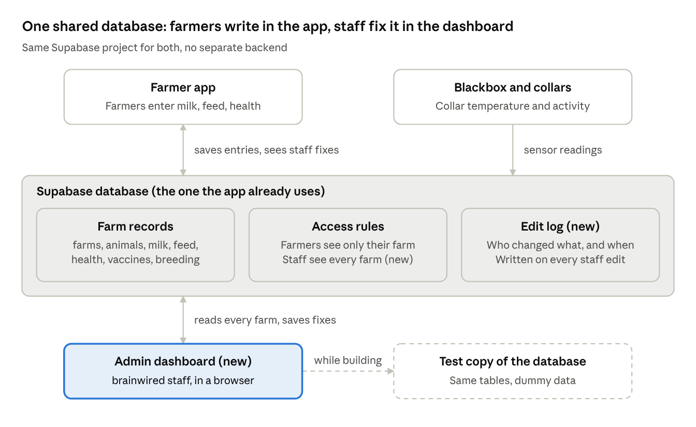

# WeSTOCK Admin Dashboard — Product & Technical Spec

Nov 6, 2026 

## Overview

WeSTOCK Admin is a web dashboard where brainwired staff can view and fix the data farmers enter in the WeSTOCK app. Following Sri's brief ("for admin yes, but only basic farm management"), phase 1 covers farm management only. The design is a click-through [prototype](https://claude.ai/artifact/9jQa5qhU3LeB3EbPcj9VxS) with 18 screens. The build starts once the design and backend access are approved.

| Topic | Decision |
| --- | --- |
| Users | brainwired staff only. Farmers never log in here |
| Where it runs | Web browser. Built for desktop, works on phone |
| Data | The same Supabase database the farmer app uses. No separate backend |
| Staff rights | View and edit farmer records. Every edit is recorded in an activity log |
| In scope (phase 1) | Farms, sheds, members, livestock, milk & feed, health & vaccines, breeding, staff access |
| Designed for later | Devices, support inbox, notifications, account deletion requests, species & languages, Gau AI assistant, weather |
| Status | Design ready. Waiting for approval, Supabase access and a test copy of the database |

**Guiding rules**

- **Match the app.** Same colours, fonts, field names, units and status labels as the farmer app, so staff and farmers see the same thing.
- **Plain words.** Labels describe the farm, not the database ("Milk entries", not "milk\_log rows").
- **Every change is traceable.** Each edit stores who made it, what changed and when.
- **The app is not touched.** The database only gets new additions. Nothing the app reads or writes today changes.

## Design system

The look comes straight from the WeSTOCK build pack (the zip): the same navy, green, section colours and fonts as the farmer app, laid out as a desktop admin.

**Core colours**

| Role | Colour | Used for |
| --- | --- | --- |
| Navy | `#0F1B2D` | Sidebar, headings, primary text on green |
| Green | `#2ED08C` | Primary buttons, active states, good trends |
| Dark green | `#0B7A4B` | Eyebrow labels, links, success text |
| Page background | `#F4F6F5` | Behind all cards |
| Card | `#FFFFFF`, border `#E5EAE7` | Every content block |
| Body text | `#1A1A1A` | Paragraphs and table cells |
| Muted text | `#6B7280` | Sub-titles, helper notes |
| Danger | `#D62F4B` | Delete and release buttons |

**Section colours** (each record area keeps its colour from the app)

| Area | Tint | Text / icon |
| --- | --- | --- |
| Breeding | `#FBE6F4` | `#A01A78` |
| Health & alerts | `#FDE8EC` | `#B4233C` |
| Vaccines / info | `#E8EDFC` | `#2A4FD6` |
| Milk | `#DDF4F9` (bars `#BEEFF7`) | `#0E6C80` |
| Feed | `#FFF1E0` | `#9A4A00` |

**Status pills**

| Pill | Colours | Meaning |
| --- | --- | --- |
| Green | `#E3F8EF` / `#0B7A4B` | Active, given, resolved, online |
| Amber | `#FFF1E0` / `#9A4A00` | Due soon, needs a look, offline |
| Red | `#FDE8EC` / `#B4233C` | Overdue, sick, open issue |
| Blue | `#E8EDFC` / `#2A4FD6` | Upcoming, scheduled |
| Pink | `#FBE6F4` / `#A01A78` | Breeding stages (in heat, pregnant) |
| Grey | `#F1F3F2` / `#374151` | Sold, deceased, in stock |

**Type**

| Style | Font | Size / weight |
| --- | --- | --- |
| Page title | Poppins | 28 px / 600 |
| Big numbers (KPIs) | Poppins, tabular figures | 28 px / 600 |
| Card labels | Nunito, uppercase | 12 px / 800 |
| Body and tables | Nunito | 14 px / 400–700 |
| Buttons | Nunito | 14 px / 800 |

**Layout and components**

- **Sidebar:** navy, 256 px, grouped as Overview · Farms · Records · Insights · Admin, with Sign out at the foot.
- **Top bar:** where you are (breadcrumb), search across farms, farmers and tags, today's date, and a bell for alerts.
- **Page header:** a small green eyebrow label, the title, one line of explanation, and the page actions on the right.
- **Cards:** white, 16 px corners. KPI cards sit in a grid that wraps to fit the screen.
- **Buttons:** primary is green with navy text, secondary is white with a border, destructive is red. All are 42 px tall.
- **Dialogs and toasts:** a dialog opens near the button that was clicked, and a dark toast confirms each action ("Invite sent to …").
- **Phone (900 px and below):** the sidebar becomes a scrollable strip across the top, cards stack in one column, wide tables scroll sideways inside their card, and secondary columns are hidden.

## How the dashboard gets its data

The dashboard has no backend of its own. It reads and writes the same Supabase database the farmer app already uses, directly, not through the app.

Farmers keep using the app as they do today. When staff fix a record, it changes in the same table, so the farmer sees the fix the next time the app loads.

- **Farmer app to database:** milk, feed, health, vaccine and breeding entries, exactly as today.
- **Blackbox and collars to database:** temperature and activity readings, through the existing `ingest-telemetry` function.
- **Dashboard to database:** staff sign in, see every farm, and save fixes. Each save also writes a row to the edit log.
- **Test copy:** everything is built and tested on a copy with dummy data. The dashboard is pointed at the live database only at launch.

## Screen map

Phase 1 has 11 screens reached from the sidebar. Another 7 screens are designed but held for later, so the first release stays focused on farm management.

| Screen | Sidebar group | What staff do there | Phase |
| --- | --- | --- | --- |
| Sign in | — | Staff log in with their work email | 1 |
| Dashboard | Overview | See every farm at a glance: totals, today's issues, farms that need attention | 1 |
| Farmers & farms | Farms | Find any farmer or farm, filter by state and language, export | 1 |
| Farm page | Farms (from the list) | One farm: sheds, members, animals, settings, ownership, delete | 1 |
| Livestock | Farms | Every animal across all farms, add animals, filter and export | 1 |
| Animal page | Livestock (from the list) | One animal: profile, status, vaccinations, health history | 1 |
| Reproduction | Records | Heat, insemination, pregnancy and delivery for every farm, verify slips | 1 |
| Milk & feed | Records | Daily milk and feed entries, fix wrong entries, monthly report | 1 |
| Health & vaccines | Records | Due and overdue vaccines, open health issues, vaccine schedules | 1 |
| Analytics | Insights | The same five graphs farmers see in the app, for any farm or animal | 1 (optional) |
| Staff & activity log | Admin | Invite staff, set roles, see every edit made from the dashboard | 1 |
| Devices | — | Blackboxes, extenders and collars: stock, claims, health | Later |
| Support inbox | — | Chat with farmers in their language | Later |
| Notifications | — | Send announcements, see alerts sent to farmers | Later |
| Account requests | — | Handle farmers' requests to delete their account and data | Later |
| Species & languages | — | Species list and their names in the six app languages | Later |
| Gau assistant | — | Review the AI assistant's chats, settings and safety tests | Later |
| Weather & heat stress | — | Heat stress (THI) for every farm | Later |

## Phase 1 screens

Each screen below lists its parts, what they show, and what staff can do there. Every edit asks for confirmation where it can't be undone, shows a confirmation message, and is written to the activity log.

### Sign in

| Part | What it shows | Staff can |
| --- | --- | --- |
| Sign-in form | Work email, password, "keep me signed in" | Sign in, show or hide the password |
| Forgot password | Email field | Get a reset link by email |
| Side panel | Farmers, active animals, milk collected per day | View only |

### Dashboard

| Part | What it shows | Staff can |
| --- | --- | --- |
| Totals | Farmers, farms (and how many run a Blackbox), active animals, milk yesterday | Click through to the matching list |
| Last 30 days | Milk collected, feed logged, vaccines given, each with its trend | Switch the period |
| Needs attention today | Golden periods ending soon, vaccines overdue, animals marked sick, may deliver this week, farms not logging milk | Jump to the matching records |
| Milk per day | Milk collected per day across all farms | View |
| Farms needing attention | Farm, location, animals, last entry, issue | Filter by issue, open the farm |
| Herd by species, farmers by language | Share of animals per species, farmers per app language | View |
| Recent staff changes | Latest edits from the activity log | Open the full log |
| Invite staff | Name, work email, role | Send an invite |

### Farmers & farms

| Part | What it shows | Staff can |
| --- | --- | --- |
| Farmers view | Totals (farmers, logged this week, quiet 3–7 days, quiet 7+ days), then farmer, app language, farms, animals, location, joined, last entry | Search, filter by state and language, export CSV, open |
| Farms view | Farm, location, sheds, animals, members, mode (manual or Blackbox), milk last 7 days | Search, filter by state, export CSV, open the farm page |
| Paging | 20 rows a page | Move between pages, clear filters |

### Farm page

| Part | What it shows | Staff can |
| --- | --- | --- |
| Header | Farm name, owner, place, mode, members, animals | Edit the farm, add an animal |
| Records on this farm | Animal, milk, feed, health and breeding counts; milk per day for 7 days; what's coming up; latest entries from the app | Open any record |
| Sheds | Code, name, animals, who lives there | Add a shed, edit a shed |
| Farm members | Name, phone, role (owner, manager, worker) | Add a member, change a role |
| Farm details | Name, owner, district, state, map location, description | Edit and save |
| Alerts | Fever alert temperature, collar offline time | Edit and save |
| Danger zone | Ownership and deletion | Transfer ownership; delete the farm after typing its name |

### Livestock

| Part | What it shows | Staff can |
| --- | --- | --- |
| Totals | Active animals, with collars, temperature high, cannot connect; tabs by species group (large ruminants, small ruminants, poultry, swine, equine) | Switch species group |
| Animal list | Animal (tag, name, breed), species, farm and shed, collar temperature, breeding stage, health | Search; filter by farm, collar, breeding and status; export CSV; open |
| Add animal | Farm, tag number, name, species, breed, gender, Pashu Aadhaar (12 digits) | Add an animal to any farm |

### Animal page

| Part | What it shows | Staff can |
| --- | --- | --- |
| Header | Name, tag, species, breed, gender, age, Pashu Aadhaar, shed, status | Mark sold or deceased (with date and note), mark active again |
| Edit animal | Tag, name, species, breed, gender, date of birth, Pashu Aadhaar, shed | Edit and save |
| Pregnancy and collar | Current cycle and gestation, body temperature today, activity today | View |
| Milk | Last 30 days | View |
| Vaccinations | Vaccine, due date, given or not | Add a vaccination, mark it given |
| Health history | What happened, status, notes | Add an event, mark it resolved |
| Reproduction history, photos | Past cycles, uploaded photos | View |

### Reproduction

| Part | What it shows | Staff can |
| --- | --- | --- |
| Stage tabs | In heat, inseminated, pregnant, with counts | Switch stage, filter by farm |
| In heat | Animal, farm, heat started, golden period, reported by, "heat alert correct?" | View; animals in their golden period are highlighted |
| Inseminated | Animal, farm, inseminated, tube number, slip photo, verified | View the slip photo, mark it verified |
| Pregnant | Animal, farm, expected delivery, gestation, cycle | View |
| Add cycle | Farm, animal, stage, when, tube number (if inseminated) | Add a heat or insemination record |

### Milk & feed

| Part | What it shows | Staff can |
| --- | --- | --- |
| Totals | Milk yesterday, milk value, milking animals, feed cost yesterday | Switch between daily and monthly |
| Charts | Milk by session for 7 days, feed by type yesterday, milk per month | View |
| Milk entries | Logged, farm and animal, session, litres, price per litre, amount, entered by | Add, fix (with a reason), delete |
| Feed entries | Logged, farm, fed to, feed type, quantity, cost, entered by | Add, fix (with a reason), delete |
| Report | Monthly totals | Download the month's report as CSV |

Fixed entries are marked "Fixed by staff" so the farmer can see what changed.

### Health & vaccines

| Part | What it shows | Staff can |
| --- | --- | --- |
| Totals | Vaccinations not yet given (overdue, due in 7 days, upcoming) and open health issues (sick, detected, long-term) | View |
| Vaccinations tab | Animal, vaccine, due date, status | Filter by farm and species, mark given, undo |
| Health issues tab | Animal, issue, status, source (farmer or collar), since | Mark resolved, undo |
| Vaccine schedule | Vaccine, give to (all cattle, all buffalo or one animal), farm, due date, note for the farmer | Create reminders for a whole herd at once |

### Analytics (optional)

| Part | What it shows | Staff can |
| --- | --- | --- |
| Filters | Farm, one animal or the whole farm, 7, 30 or 90 days | Switch any of these |
| 1 · Milk | Litres per day, value | View |
| 2 · Feed | Kilograms per day, cost, feed mix | View |
| 3 · Activity | Hours per cow per day: ruminating, standing, sitting, eating, walking, drinking | View |
| 4 · Cattle temperature | Herd average and highest cow, with the fever line | View |
| 5 · Farm temperature | Temperature, humidity and THI by hour for a chosen day | Pick the day, pick the shed |
| Download | The graphs' numbers | Download as CSV |

### Staff & activity log

| Part | What it shows | Staff can |
| --- | --- | --- |
| Staff list | Name, role, last active, status | Invite, change role, remove, cancel an invite (super admin only) |
| Roles | What each role can do | View |
| Activity log | When, staff, action, record, change (before and after) | Filter by staff, action and period; export CSV; load more |

## Later screens

These seven screens are designed and clickable but are not in phase 1. Most of them depend on hardware or features the app is still rolling out. Each can be added later without changing the phase 1 screens.

| Screen | What it shows | Staff can | Built on (app data) |
| --- | --- | --- | --- |
| Devices | Blackboxes, extenders and collars: farm, shed, battery, last seen, status; one Blackbox's power, chip temperatures, extenders and sync log | Search and filter; move an extender to another shed; release a device back to stock; unlock a locked QR claim; create devices before they ship and download their QR labels | `devices`, `device_inventory`, `device_health`, `device_sync_log` |
| Support inbox | Conversations from the app's Messages tab, with tabs for waiting, mine, vet advisor and closed; the farmer's farm and open items | Search, assign to a staff member, reply in the farmer's language, attach a photo, close or reopen a chat | `chat_threads`, `chat_messages` |
| Notifications | Alerts sent to farmers (heat, high temperature, vaccine due, delivery, device offline, heat stress), plus announcements | Filter by type; write an announcement in each app language; choose who gets it (heat-stressed farms, everyone, by language, by state, farms with hardware, one farm); send now or schedule | `notifications`, `push_tokens` |
| Account requests | Farmers asking to delete their account, with the 4 steps to handle each one | Export the farmer's data as a file, then delete the account after typing DELETE | `profiles`, `farms` and all farm records |
| Species & languages | Each species, its category, collar support, gestation, number of animals, and its name in Hindi, Marathi, Malayalam, Gujarati and Tamil | Add a species, edit names; missing translations are flagged | `species` |
| Gau assistant | Recent chats with the AI assistant, what it suggested, safety rules and test results per language | Filter chats by outcome, change the model and daily message limit, run the safety tests again | `gau-chat` function, `chat_threads` |
| Weather & heat stress | Every farm's temperature, humidity and THI, with the week's trend | Filter by state, open a farm | `environment_readings`, `thi()` |

## Data model

The dashboard uses the tables already defined in the build pack (`supabase/migrations/0001–0004`) and adds 2 new tables, 3 new farm columns and an admin access rule. Nothing the app reads or writes today is renamed or removed.

### Existing app tables used in phase 1

| Table | Key fields | Dashboard access | Screens |
| --- | --- | --- | --- |
| `profiles` | full\_name, phone, language | Read | Farmers, farm members |
| `farms` | owner\_id, name, description, lat, lng, settings | Read + edit, delete | Farmers & farms, farm page |
| `farm_members` | farm\_id, user\_id, role (owner, manager, worker) | Read + edit | Farm page |
| `sheds` | farm\_id, code, name | Read + edit | Farm page |
| `species` | id, category, hardware\_supported, labels in 6 languages | Read | Livestock filters, add animal |
| `animals` | tag\_number, name, species\_id, breed, gender, dob, pashu\_aadhaar, shed\_id, status, photo\_urls | Read + edit | Livestock, animal page |
| `milk_entries` | entry\_date, session (morning, afternoon, evening), litres, price\_per\_litre, created\_by | Read + edit, delete | Milk & feed |
| `feed_entries` | entry\_date, shed\_id or animal\_id, feed\_type, quantity\_kg, cost, created\_by | Read + edit, delete | Milk & feed |
| `vaccinations` | vaccine\_name, description, due\_date, done\_date | Read + edit | Health & vaccines, animal page |
| `health_events` | title, notes, status (detected, sick, condition, resolved), detected\_at, resolved\_at, source | Read + edit | Health & vaccines, animal page |
| `reproduction_cycles` | cycle\_no, status (heat, inseminated, pregnant, delivered, failed, closed), golden\_start/end, inseminated\_at, tube\_number, insemination\_verified, insemination\_image\_url, expected\_delivery | Read + edit | Reproduction, animal page |
| `sensor_readings`, `activity_daily`, `environment_readings` | Collar temperature and activity, shed temperature, humidity, THI | Read only | Analytics, animal page |

The app's existing database functions `farm_dashboard()`, `analytics_series()` and `thi()` are reused for the totals and graphs, so the dashboard calculates them the same way the app does.

### New additions (one migration, proposed as `0005_admin.sql`)

| Addition | Fields | Why it's needed |
| --- | --- | --- |
| `admin_staff` table | user\_id, full\_name, work email, role (super\_admin, support, viewer), status (invited, active, removed), invited\_by, last\_active\_at | Decides which brainwired staff can open the dashboard and what each can do |
| `admin_audit_log` table | id, at, staff\_id, action, table\_name, record\_id, farm\_id, field, old\_value, new\_value, note | Records every edit made from the dashboard: who, what, when, before and after |
| `farms.district`, `farms.state` | text | Lets staff filter farms by state and district. The app only stores a map pin (lat, lng) |
| `farms.poultry_count` | integer | Birds are counted per farm, not tagged one by one, so the app has no place for this number yet |
| Admin access rule | `is_admin_staff()` check plus read and edit rules on each farm table | Today every table only opens to members of that farm. Without this rule, a staff login would see no farms |

**How the edit log is written:** a database trigger on each table the dashboard can edit writes the log row in the same save. An edit can't skip the log, even if someone changes the dashboard code later. Edits made by farmers in the app are not logged here.

## Roles and the activity log

There are three staff roles. Everyone can see every farm. Only Support and Super admin can change records, and only a Super admin can manage staff.

| What staff can do | Super admin | Support | Viewer |
| --- | --- | --- | --- |
| See every farm, farmer, animal and record | Yes | Yes | Yes |
| Download CSV exports and reports | Yes | Yes | Yes |
| Add or edit animals, sheds, members, farm details | Yes | Yes | No |
| Fix or delete milk and feed entries | Yes | Yes | No |
| Mark vaccines given, health issues resolved, slips verified | Yes | Yes | No |
| Create vaccine schedules, add breeding records | Yes | Yes | No |
| Transfer farm ownership | Yes | Yes | No |
| Delete a farm and its records | Yes | No | No |
| Invite, remove staff and change their roles | Yes | No | No |
| See the activity log | Yes | Yes | Yes |

Support can't delete farms. That limit isn't in the clickable design yet; it is proposed here because a deleted farm can't be recovered. Confirm or change it before the build.

**Activity log rules**

| Rule | Detail |
| --- | --- |
| What is logged | Every create, edit, delete, transfer and verify made from the dashboard, plus staff invites, role changes and removals |
| What each row holds | When, staff member, action, record and farm, field changed, value before and after, note or reason |
| Reasons | Fixing a milk or feed entry asks for a reason, which is saved with the change |
| Who can change the log | Nobody. Rows can't be edited or deleted, not even by a Super admin |
| Removed staff | Their past changes stay in the log with their name |
| Viewing | Filter by staff, action and period; export as CSV |

## What's needed, build plan and open questions

The build can start once these three things are approved and shared.

| Needed from brainwired | Why |
| --- | --- |
| Supabase project URL and anon key | The dashboard connects to the same database as the app. The anon key is safe in a browser because the access rules decide what each login can see |
| A test copy of the database (same tables, dummy data) | All building and testing happens there, so real farmers' data is never touched. If there isn't one, the table structure is enough to set one up |
| OK to run the one new migration (`0005_admin.sql`) | Adds staff roles, the edit log, district/state and poultry count. It runs on the test copy first and on live only at launch |

**Build plan**

1. Design and this spec approved.
2. Access shared: project URL, anon key, test copy.
3. Repo set up; sign-in, staff roles and the edit log working on the test copy.
4. Farms: Farmers & farms, farm page, Livestock, animal page.
5. Records: Reproduction, Milk & feed, Health & vaccines.
6. Dashboard home, Staff & activity log, then Analytics.
7. brainwired staff try it on the test copy; fixes.
8. Migration run on the live database; dashboard pointed at live; launch.

**Open questions**

- [ ] Can Support delete a farm, or only a Super admin?
- [ ] Is there a staging Supabase project already, or should one be set up from the schema?
- [ ] Which email domain do brainwired staff sign in with?
- [ ] Who are the first Super admins?
- [ ] Where will the dashboard be hosted, and at what web address?
- [ ] Is Analytics in phase 1, or moved to later?
- [ ] Who fills district and state for existing farms: the farmer in the app, staff, or worked out from the map pin?
- [ ] Should the farmer app also show and edit the poultry count?
- [ ] How long should the activity log be kept?
